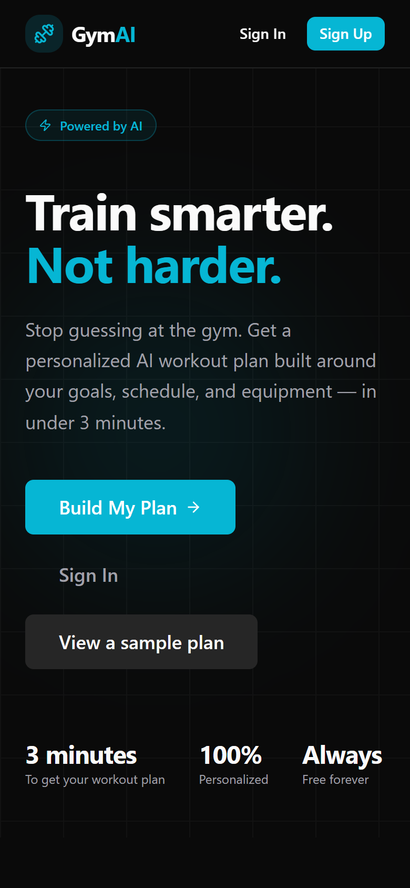
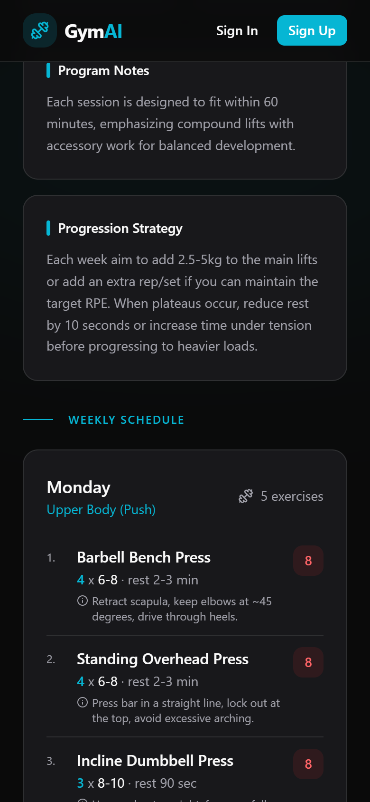
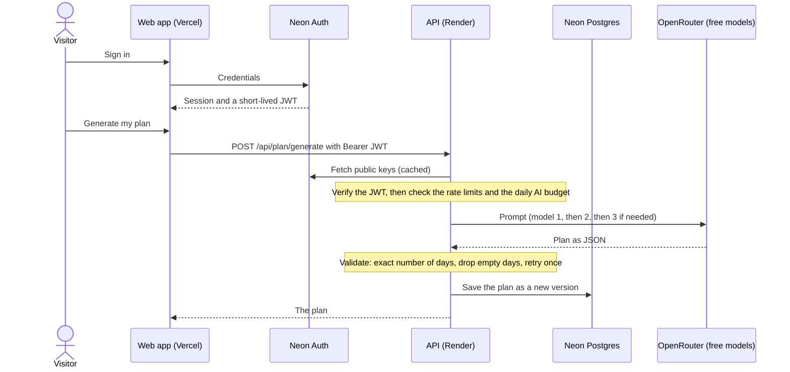

# GymAI Planner

[](https://github.com/jamescastro-dev/gym-ai-planner/actions/workflows/ci.yml)

An AI workout planner: answer a few questions about your goal, experience, schedule and equipment, and get a personalized weekly training plan with sets, reps, rest, RPE, form cues and exercise alternatives.

**Live demo: [gym-ai-planner.vercel.app](https://gym-ai-planner.vercel.app)**
No account needed to see what it produces: open **View a sample plan**.

> The backend runs on a hosted service that can take a little while to wake up after a period of inactivity, and plan generation itself takes roughly 30–60 seconds. Both are normal.

## Screenshots

<p>
  
  &nbsp;&nbsp;
  
</p>

<sub>390px-wide captures with mocked data. More (the questionnaire, the "AI is busy" fallback, the daily-limit message and desktop views) are in [`docs/screenshots`](docs/screenshots).</sub>

## What it does

- **Sign up / sign in** with Neon Auth.
- **Questionnaire** for goal, experience, days per week, session length, equipment, preferred split and injuries.
- **AI-generated weekly plan** saved to your account, with a version history that grows each time you regenerate.
- **Sample plan** page that works without an account (and even when the AI or the backend is down).
- **Graceful failure.** If the AI is busy you get a clear message and a link to the sample plan, never a raw error.
- **Responsive**, including a phone layout for the plan tables.

## Tech stack

| Layer | Tools |
| --- | --- |
| Frontend | React 19, TypeScript, Vite, Tailwind CSS 4, React Router, Lucide icons |
| Auth | [Neon Auth](https://neon.com/docs/auth/overview) (`@neondatabase/neon-js`) |
| Backend | Node.js, Express 5, TypeScript, [`jose`](https://github.com/panva/jose) (JWT verification), `express-rate-limit` |
| Database | PostgreSQL on [Neon](https://neon.com), via Prisma 7 |
| AI | [OpenRouter](https://openrouter.ai) with free models (`:free`), through the OpenAI SDK |
| Hosting | Vercel (frontend), Render (backend) |

## How it works



**Plan generation.** `OPENROUTER_MODELS` is an ordered list of free models. If one returns 404 or 429, an empty reply, or invalid JSON, the next is tried, with a hard cap of **3 requests per plan** (failed requests can still count toward OpenRouter's free daily limit). The reply is validated: it must contain exactly the requested number of training days, empty days are dropped, and bad output gets one retry.

**Limits that protect the free quota** (all configurable, see below): 3 plans per user per day (stored in the database), 10 generation requests per IP per day, one generation at a time per user, and a daily cap on OpenRouter requests kept under the free limit of 50.

### API

All `/api` routes require `Authorization: Bearer <Neon Auth JWT>`.

| Method | Path | Description |
| --- | --- | --- |
| `GET` | `/health` | Public health check (use it for an uptime monitor). |
| `POST` | `/api/profile` | Create or update the signed-in user's questionnaire answers. |
| `POST` | `/api/plan/generate` | Generate a new plan from the saved profile. |
| `GET` | `/api/plan/current` | The signed-in user's latest plan, or `null`. |

Errors are JSON: `{ "error": "…", "code": "AI_BUSY" }`. Codes include `AI_BUSY`, `AI_QUOTA`, `DAILY_LIMIT`, `RATE_LIMITED`, `IN_PROGRESS`, `PROFILE_REQUIRED`, `INVALID_PROFILE`, `UNAUTHENTICATED` and `INVALID_TOKEN`.

## Engineering notes

What went wrong in the first version of this project and how it was fixed. The decisions behind the code:

- **A deprecated free model took the app down.** Plan generation used one hard-coded free model. When OpenRouter removed it from the free tier, every generation failed. The model list is now configuration, tried in order, and a reply is only accepted if it parses and has exactly the requested number of days. Attempts are capped at 3 per plan, because failed requests still count toward the free daily quota.
- **The API trusted the client for the user id.** Routes took a `userId` from the request, so anyone who knew an id could read or write that person's data. The server now verifies Neon Auth's signed JWT (EdDSA, against the published keys) and takes the id from the token. If the auth URL is not configured, the API refuses every request rather than letting them through.
- **A free quota is a resource to defend.** Plans are limited per user (counted in the database), per IP and per day across all visitors, and only one generation per user can run at a time. When any limit is hit, or the AI is busy, the visitor sees a plain message and a link to a sample plan, never a raw error.
- **Tests use real cryptography, not mocks of it.** The auth tests sign tokens with real EdDSA keys and serve them from a local key endpoint, so they check that wrong signatures, wrong issuers and expired tokens are rejected. The AI tests cover the fallback order, the attempt cap and every kind of bad output.
- **Found by running it in a real browser.** The Neon Auth SDK's `token()` call returns the session, not a JWT, and the browser cannot read the token header directly in every setup. The client therefore takes the token from the session and falls back to the auth server's token endpoint. A unit test would not have caught this.

## Local setup

**Prerequisites:** Node.js 22 or newer, a [Neon](https://neon.com) project with **Neon Auth** enabled, and a free [OpenRouter](https://openrouter.ai/settings/keys) API key.

```bash
# 1. Install
npm install
cd server && npm install && cd ..

# 2. Configure (then edit both files, see "Environment variables")
cp .env.example .env
cp server/.env.example server/.env

# 3. Prepare the database and the Prisma client
cd server
npx prisma migrate deploy
npx prisma generate
cd ..

# 4. Run the backend (http://localhost:3001) and, in a second terminal, the frontend (http://localhost:5173)
cd server && npm run dev:server
npm run dev
```

For local development set `VITE_API_URL=http://localhost:3001` in `.env`. Sign-in from `http://localhost:5173` works out of the box; Neon Auth accepts it as a trusted origin.

> The migration creates the `user_profiles` and `training_plans` tables. If your `DATABASE_URL` is a pooled (`-pooler`) Neon connection, use the direct (non-pooled) connection string for `prisma migrate deploy`.

### Environment variables

**Frontend** (`.env`, public values compiled into the bundle, never put secrets here):

| Variable | Description |
| --- | --- |
| `VITE_API_URL` | Backend base URL: `http://localhost:3001` locally, your Render URL in production. |
| `VITE_NEON_AUTH_URL` | Neon Auth URL (Neon Console → Auth). |

**Backend** (`server/.env`, or Render's Environment tab):

| Variable | Required | Description |
| --- | --- | --- |
| `DATABASE_URL` | yes | Neon Postgres connection string. |
| `OPEN_ROUTER_KEY` | yes | OpenRouter API key. |
| `NEON_AUTH_URL` | yes | Same value as `VITE_NEON_AUTH_URL`. Used to verify sign-in tokens; without it every `/api` request is rejected. |
| `NEON_AUTH_ISSUER` | no | Expected `iss` claim of sign-in tokens. Defaults to the origin of `NEON_AUTH_URL`; only set it if the logs say the issuer does not match. |
| `OPENROUTER_MODELS` | no | Ordered, comma-separated models. Each must end in `:free` (anything else is ignored). |
| `ALLOWED_ORIGINS` | no | Comma-separated browser origins allowed to call the API. Add a custom domain here. |
| `PLANS_PER_USER_PER_DAY` | no | Default `3`. |
| `GENERATE_REQUESTS_PER_IP_PER_DAY` | no | Default `10`. |
| `AI_DAILY_BUDGET` | no | OpenRouter requests per UTC day, default `45`. |
| `TRUST_PROXY_HOPS` | no | Reverse proxies in front of the server, default `1`. |
| `PORT`, `BASE_URL` | no | Listen port (Render sets it) and the Referer sent to OpenRouter. |

See [`server/.env.example`](server/.env.example) for details and the models that were tested.

### Scripts

| Where | Command | What it does |
| --- | --- | --- |
| root | `npm run dev` | Frontend dev server. |
| root | `npm run build` | Type-check and build the frontend. |
| root | `npm run lint` | ESLint (frontend and server). |
| `server/` | `npm run dev:server` | Backend with auto-reload. |
| `server/` | `npm run build` / `npm start` | Generate the Prisma client and compile; run the compiled server. |
| `server/` | `npm test` | Unit tests for the model fallback, output validation and JWT verification (Node's built-in test runner). |

## Deployment

**Backend (Render)**: a Node web service with the root directory set to `server`:

| Setting | Value |
| --- | --- |
| Build command | `npm install && npm run build` |
| Start command | `npm start` |
| Environment | `DATABASE_URL`, `OPEN_ROUTER_KEY`, `NEON_AUTH_URL`, `OPENROUTER_MODELS` (see above) |

Deploy the backend first, then the frontend. After the first deploy check the logs: the `[config]` lines show the models and allowed origins in use, and the `[proxy-check]` line printed on the first generation should show a visitor's address as `req.ip`. If it shows your host's proxy address, change `TRUST_PROXY_HOPS`.

**Frontend (Vercel)**: import the repo with the Vite preset. Set `VITE_API_URL` (the Render URL, no trailing slash) and `VITE_NEON_AUTH_URL`, then redeploy. These values are baked in at build time, so changing them needs a new build. `vercel.json` rewrites every route to `index.html` for client-side routing.

**Verify sign-in after deploying.** Sign in on the live site and open your plan, then check the backend logs:

| Log line | Meaning |
| --- | --- |
| `[auth] first token verified OK (user xxxxxxxx…)` | Working. |
| `[auth] token rejected: unexpected "iss" claim value (claimed iss="…")` | Tokens use a different issuer. Set `NEON_AUTH_ISSUER` to the claimed value; no code change needed. |
| `[auth] token rejected: signature verification failed` or `no applicable key found` | `NEON_AUTH_URL` points at a different Neon project than the frontend. |
| `[config] NEON_AUTH_URL is not set` | Add the variable. |
| No `[auth]` line, but the app says "Please sign in again" | The browser could not get a token. Its console shows `[auth] could not get an access token for the API: …` with the reason. |

**Rolling back.** Roll back the backend and the frontend together: the new backend requires a sign-in token that an old frontend does not send, and the reverse is also true.

- *Render*: service → **Events** → a previous successful deploy → **Rollback**. This restores that deploy's code **and its environment variables**, and it **turns off auto-deploy**, so re-enable it once the problem is fixed.
- *Vercel*: **Deployments** → the previous production deployment → **Instant Rollback**. On the Hobby plan you can only go back one production deployment.
- Variables such as `NEON_AUTH_ISSUER` are fixed by editing the variable (the service restarts), not by rolling back.

**Keep-alive**: point an uptime monitor at `GET /health` if your host sleeps idle services.

## Known limitations

- Free models change. They get removed, slowed down or rate-limited from time to time, which is why the list is configuration and not code. Check the tested list in `server/.env.example` and re-test slugs against `https://openrouter.ai/api/v1/models` when generation starts failing.
- The per-IP limit and the daily AI request cap are held in memory and reset when the server restarts. The per-user limit is stored in the database and survives restarts.
- Generation is synchronous (a single request that waits for the AI), so it is capped at 90 seconds.
- Neon Auth and `@neondatabase/neon-js` are in beta; the SDK version is pinned to the 0.2 line.

## Project structure

```
src/                     React app
  components/plan/       Plan rendering (table on desktop, stacked rows on phones)
  context/AuthContext    Session, current plan, save profile / generate plan
  data/samplePlan.ts     Anonymized real plan used by the sample page
  lib/api.ts             API client (adds the Neon Auth token, handles errors and timeouts)
  lib/auth.ts            Neon Auth client and token helper
  pages/                 Home, Onboarding, Profile, SamplePlan, Auth, Account
server/
  src/index.ts           Express app, CORS, routing
  src/routes/            /api/profile and /api/plan
  src/lib/ai.ts          Model fallback, prompt, output validation
  src/lib/auth.ts        JWT verification middleware
  src/lib/limits.ts      Rate limits
  prisma/                Schema and migrations
```
